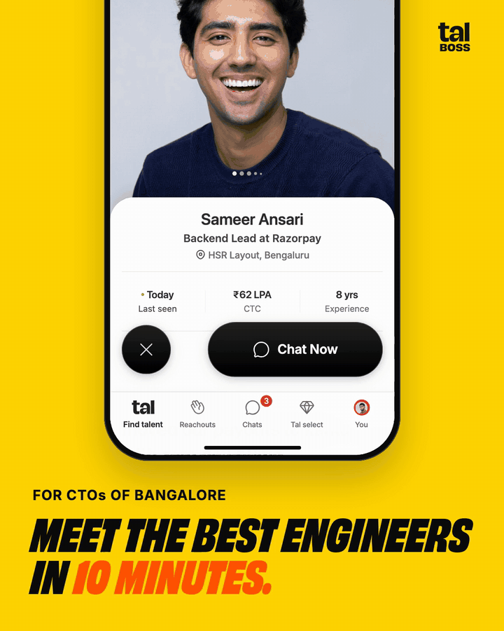
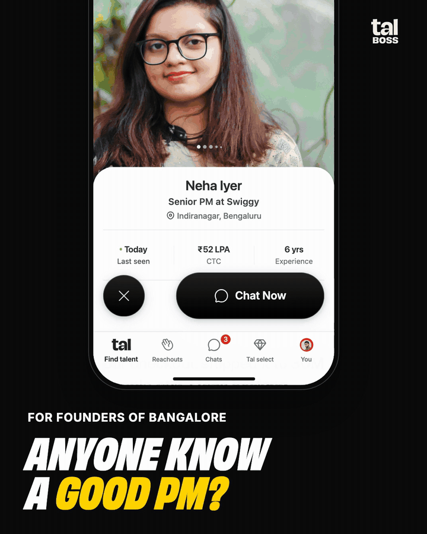
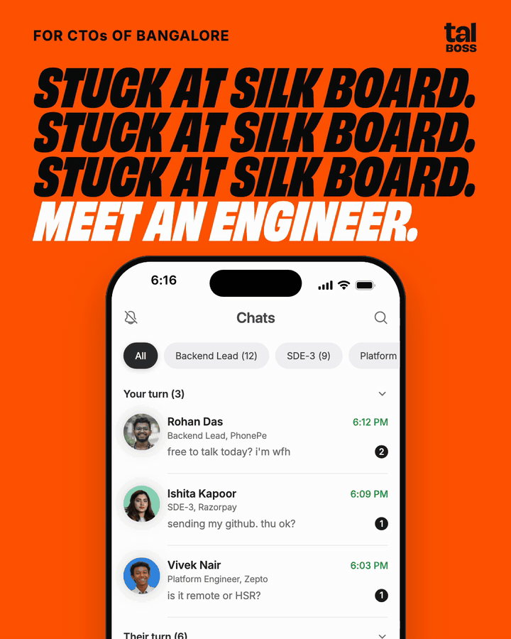
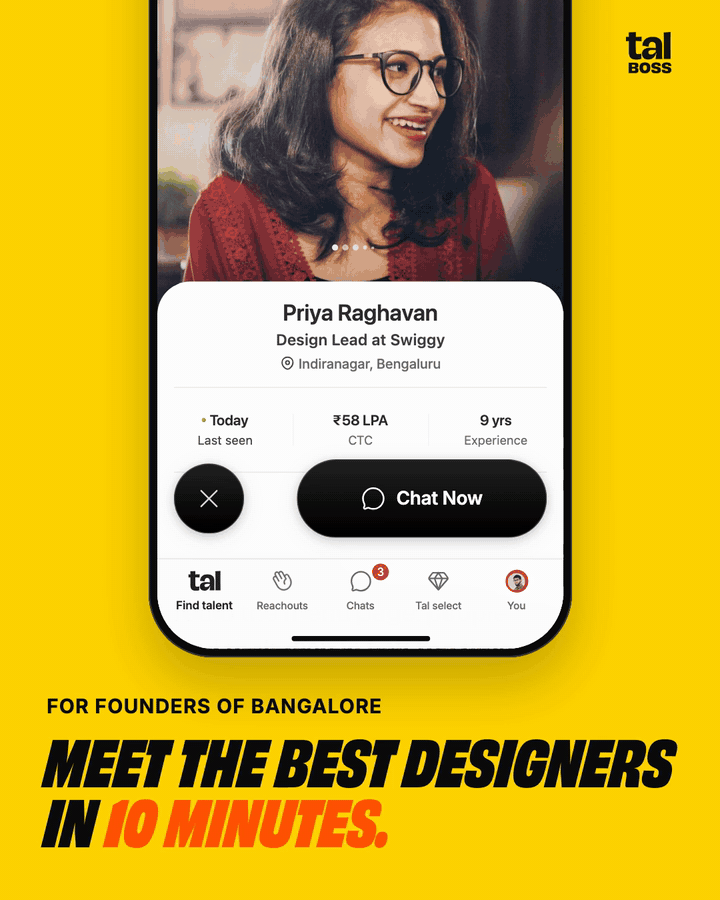
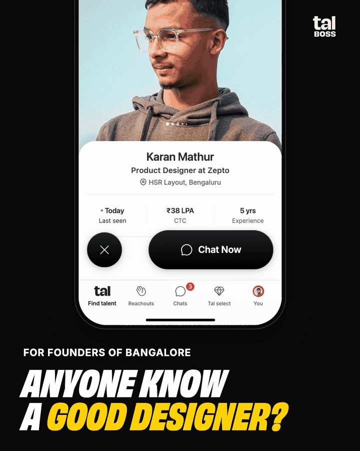
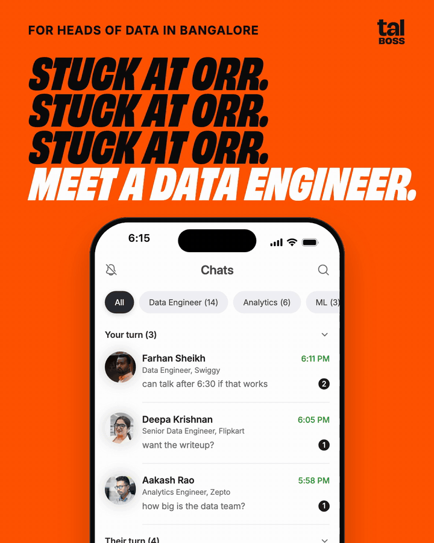

# Tal Boss GIF ads

The Remotion source for three Tal Boss GIF ads (1080×1350, 4:5, 30 fps), plus the approved renders. Names, faces and copy are props. You can make a new version without touching the animation code.

| The Reply | Tal Does | Silk Board |
|---|---|---|
|  |  |  |
| Comp `R7-Reply` · [`variants/reply.json`](variants/reply.json) | Comp `R7-TalDoes` · [`variants/tal-does.json`](variants/tal-does.json) | Comp `R7-SilkBoard` · [`variants/silk-board.json`](variants/silk-board.json) |
| [GIF](renders/r7-reply.gif) · [MP4](renders/r7-reply.mp4) | [GIF](renders/r7-tal-does.gif) · [MP4](renders/r7-tal-does.mp4) | [GIF](renders/r7-silk-board.gif) · [MP4](renders/r7-silk-board.mp4) |

Example variants, made only by changing props:

| Design Lead at Swiggy | A good designer? | Stuck at ORR |
|---|---|---|
|  |  |  |
| [`variants/reply-design-lead.json`](variants/reply-design-lead.json) | [`variants/tal-does-designer.json`](variants/tal-does-designer.json) | [`variants/silk-board-orr.json`](variants/silk-board-orr.json) |

## Run it

You need Node 18+ and ffmpeg (`brew install ffmpeg`). Put the licensed fonts in `public/fonts/` first (see [Fonts](#fonts)).

```bash
npm install
npm run dev                                   # Remotion Studio: preview and edit every ad
npm run render -- variants/reply.json         # -> out/reply.mp4 + out/reply.gif
npm run render:all                            # every file in variants/
```

## How to make a new version

**In the Studio.** Run `npm run dev`, pick a comp and edit the props panel on the right. Photos are a dropdown, colours have a picker, and the layout updates as you type. When it looks right, switch the panel to its JSON view, copy it into a new file in `variants/` and render that file (below). The Studio's own render button works too.

**As a file.** Copy a JSON in `variants/`, change it, and render it:

```bash
cp variants/reply.json variants/reply-sales-head.json
# edit the copy: person, photo, company, messages...
npm run render -- variants/reply-sales-head.json
```

That writes `out/reply-sales-head.mp4` and `out/reply-sales-head.gif` (720 wide, 15 fps). The ad is picked from the file name: `reply-*`, `tal-does-*` or `silk-board-*`. You can also name it: `npm run render -- R7-Reply variants/x.json`. Add `--gif1080` for a 1080-wide GIF too, or `--no-gif` for the MP4 only.

The GIF recipe is `fps=15,scale=720:-1:flags=lanczos,split[a][b];[a]palettegen=max_colors=160[p];[b][p]paletteuse=dither=bayer:bayer_scale=4`.

Rules of thumb:

- Write headlines in capitals. Wrap words in `*stars*` for the accent colour: `IN *10 MINUTES.*`.
- Longer headlines shrink to fit the frame. Shorter is still better.
- Chat text is laid out from the copy: longer messages and answers make taller bubbles and the stamps, scroll and thread follow.
- Messages should sound like someone typing on their phone: lower case, short, no sales talk.
- Company names are plain text (no logos).
- Every render checks the props against the ad's schema. A bad value (say, a photo name that doesn't exist) stops with a message naming the field.

## Props

All three ads share these:

| Prop | What it is |
|---|---|
| `audience` | The small line, e.g. `FOR CTOs OF BANGALORE`. Shown exactly as typed. |
| `colors` | Background, text and accent colours. The brand palette is in `src/brand.tsx`. |
| `bossPhoto` | The boss's own avatar in the tab bar. |
| `endCard.logo` | `dark` or `cream` wordmark (also the small corner logo). |
| `endCard.installLabel` | The pill text, `Install Now`. |
| `endCard.pill` | `dark` (black pill) or `light` (white pill). |
| `endCard.storeBadges` | Show the App Store / Google Play badges. |

A **candidate** (Reply and Tal Does) is:

| Field | Example |
|---|---|
| `name` | `Sameer Ansari` |
| `title`, `company` | `Backend Lead`, `Razorpay` (shown as "Backend Lead at Razorpay" and "Backend Lead, Razorpay") |
| `area`, `city` | `HSR Layout`, `Bengaluru` |
| `years`, `ctc` | `8 yrs`, `₹62 LPA` |
| `question`, `answer` | The profile prompt. Answers up to about four lines. |
| `photo` | A face from `public/people/` (dropdown in the Studio). |
| `focusX`, `focusY`, `zoom` | Where the face sits in the photo (0 to 1) and how close to crop. |
| `photoFit` | For tight photos: `{ "height": 300, "top": 66 }` shows the whole photo instead of cropping. Usually `null`. |
| `scrollNudge` | Extra scroll, in app points, past the automatic "answer above the dock" scroll. Usually `0`. |

### The Reply (`R7-Reply`)

| Prop | What it is |
|---|---|
| `headlineLine1`, `headlineLine2` | `MEET THE BEST ENGINEERS` / `IN *10 MINUTES.*` |
| `candidate` | The profile, then the person in the chat. |
| `hiringFor` | The role in the chat header ("For: Backend Lead"). |
| `message` | The boss's message and its time. The time (without AM/PM) is the big stamp on the right. |
| `reply` | Their reply and its time. The big stamp on the left. |
| `meet` | The Meet invite: `when`, `what`, `time`. |
| `chips` | The quick replies over the keyboard (1 to 3, keep them short). |

### Tal Does (`R7-TalDoes`)

| Prop | What it is |
|---|---|
| `questionLine1`, `questionLine2` | `ANYONE KNOW` / `A *GOOD PM?*` |
| `answer` | `TAL DOES.`, in the accent colour. |
| `candidates` | Exactly three profiles, in order. The boss chats with the third. |
| `hiringFor`, `message`, `reply`, `chips` | The chat with the third candidate. |

### Silk Board (`R7-SilkBoard`)

| Prop | What it is |
|---|---|
| `line`, `repeat` | The repeated line (`STUCK AT SILK BOARD.`) and how many times (1 to 5). More lines make the type smaller so the wall still ends above the phone. |
| `lastLine` | The line under it in the highlight colour (`MEET AN ENGINEER.`). |
| `clock` | The phone's clock, `6:16`. |
| `tabs` | The filter chips: `{ "label": "Backend Lead", "count": 12 }`. `count: null` shows no number. |
| `yourTurn` | Exactly three chats, answered in order. Each has `person`, `hiringFor`, `incoming` (1 to 3 messages; their count is the unread badge, the last one's time shows in the list), `preview` (the list line), `answer` (text and time) and `meetInvite` (set it to send a Meet invite instead of the text; `null` for a text answer). |
| `theirTurn` | Rows already waiting on the candidate: `person`, `preview`, `time`. |
| `theirTurnTotal` | The number in "Their turn (n)" before the boss starts. |

## Fonts

The headlines use **Obviously** (OH no Type Co) and the app screens use Apple's **SF Pro**. Both are licensed and are not in this repo (`public/fonts/` is gitignored). Put these files in `public/fonts/`:

- From the team's Obviously licence: `ObviouslyNarrowBlackItalic.otf`, `ObviouslyNarrowBold.otf`
- From [developer.apple.com/fonts](https://developer.apple.com/fonts/) (SF Pro): `SF-Pro-Display-Regular.otf`, `SF-Pro-Display-Medium.otf`, `SF-Pro-Display-Semibold.otf`, `SF-Pro-Text-Regular.otf`, `SF-Pro-Text-Medium.otf`, `SF-Pro-Text-Semibold.otf`

Without them the ads still render, in Inter and the system font. The render script warns you, and so does the browser console in the Studio. Those renders won't match the approved look.

Inter comes from Google Fonts at render time, so you need to be online.

The Obviously Black Italic cut only has letters, digits, full stop and comma. Any other character in a headline (`?`, `!`, `'`, `&`, `-`) is drawn in Obviously Narrow Bold, slanted to match. You don't need to do anything for this.

## Photos

`public/people/` is the face library. Each face has a 1035×690 photo and a `_sq.jpg` square crop for avatars.

To add a face, put `name.jpg` (1035×690) and `name_sq.jpg` (square) in `public/people/`, and add `"name"` to `src/people.ts`.

## Checked against the approved ads

The defaults (`variants/reply.json`, `tal-does.json`, `silk-board.json`) reproduce the approved renders in `renders/`. Rendered with `npm run render`, The Reply and Silk Board are bit-identical to the approved MP4s. Tal Does matches at SSIM 0.99999 (PSNR 64 dB). The only difference is a one-pixel row at the bottom edge of the phone screen, under the blurred tab bar. Two renders of the same code differ from each other there by the same amount. Stills of 20 frames across all three ads are pixel-identical to the original project's code.

## What's where

- `variants/`: one JSON per version. The three defaults are also the Studio's default props.
- `scripts/render.mjs`: the render command (MP4 + GIF).
- `src/Root.tsx`: the three comps, with their schemas and default props.
- `src/ads/Reply.tsx`, `TalDoes.tsx`, `SilkBoard.tsx`: each ad's timeline, layout and prop schema.
- `src/schema.ts`: shared prop shapes (candidate, message, end card).
- `src/kit/phone.tsx`: the iPhone and the rebuilt Tal Boss screens (Find talent, chat, chat list) and the motion helpers.
- `src/kit/type.tsx`: headlines (accent, punctuation, auto-fit), the audience line and the end card.
- `src/kit/measure.ts`: measures text, so layout follows the copy.
- `src/brand.tsx`: brand colours, fonts and the font fallback.
- `src/people.ts`: the list of faces.
- `public/brand/`: the tal BOSS wordmark (dark and cream) and store badges.
- `renders/`: the approved MP4 and GIF of each ad, and the example variants' GIFs.
